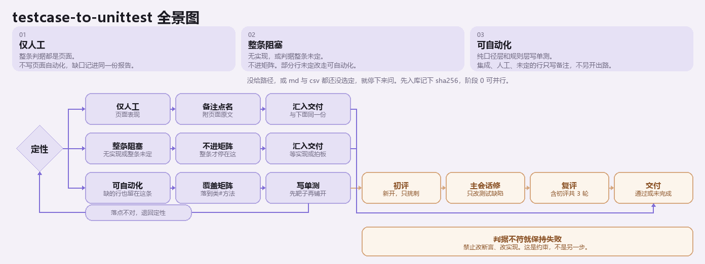

# testcase-to-unittest

[](https://skills.sh/zouaiyong/testcase-to-unittest)

把已定稿、带 TC 编号的功能测试用例落成自动化单测。断言只来自用例判据；实现不符时测试保持失败，交给开发改实现。不改断言，不改开发代码。

用例还没写用 `testcase-design`，评审用例本身用 `testcase-closed-loop`。前提是用例已定稿、实现代码已存在。执行规则在 [SKILL.md](SKILL.md)。



## 流程

先收用例，再往下走。没给用例路径就停下来问。同一需求的 md 和 csv 都在时，先问以哪份为准。阶段 0 可以和入库并行。每阶段的完成标准在 [references/stage-contracts.md](references/stage-contracts.md)，不满足不得进入下一阶段。

| 阶段 | 做什么 |
|---|---|
| 入库 | 把定稿用例和评审指引复制到被测项目的 `doc/testcases/`，记下源路径和 sha256。这是本次执行的判据基线。用例中途更新只能重新入库换基线，不能直接改副本 |
| 0 探测 | 记下语言、测试框架、mock、ORM、构建插件、测试引擎的具体版本，跑一次基线并记下测试条数 |
| 1 定性 | 每条 TC 对上代码落点，归入四态：`可自动化` / `仅人工` / `无实现-阻塞` / `判据未定-阻塞`。找不到实现要用检索证明，不当 bug |
| 2 拆解 | 可自动化的用例定层、定 Tag、落到类#方法，写成覆盖矩阵。不写断言的行要附依据 |
| 3 实现 | 先搭脚手架，用一条判据明确的靶子用例验证，再按矩阵铺开。引用写成 `文件名#TC-0008` |
| 4 评审 | 独立子 agent 只挑刺，主会话只改测试缺陷。最多 3 轮。停在「评审通过」或「用满 3 轮」，不停在「测试变绿」 |
| 5 交付 | 测试缺陷清单、失败定位清单、七节单测报告。结论只有「通过」或「未完成」 |

定性后三条出路：

- **不归单测**：人工层、集成层只登记缺口，不写页面自动化，不写真库脚本。
- **整条阻塞**：无实现，或判据整条未定。不进矩阵，等实现或业务拍板。
- **可自动化**：纯口径层（纯函数、公式、精度）和规则层（Mock，不起容器、不连库）写单测。本 skill 只产出这两层的代码。

判据和实现不符时测试保持失败：禁止改断言，禁止改开发实现，禁止用标记把失败排除出报告。四条硬约束的完整表述在 [SKILL.md](SKILL.md)。

入库、探测、定性、拆解合并落在 `doc/testcases/{需求名称}-自动化覆盖矩阵.md`。评审原文追加到 `{需求名称}-评审记录.md`，交付时再写 `{需求名称}-单测报告.md`。

## 安装

```bash
npx skills add zouaiyong/testcase-to-unittest
```

会装到 `~/.agents/skills/testcase-to-unittest`。WorkBuddy、Claude Code 不读这个目录，装完后让对应 Agent 把该路径软链接到自己的 skills 目录（WorkBuddy：`~/.workbuddy/skills/testcase-to-unittest`；Claude Code：`~/.claude/skills/testcase-to-unittest`）。Windows 建不了软链接就用目录联接。链好后新开一轮对话即可被发现。

也可以把本仓库直接放到上述目录。目录里必须有 `SKILL.md`。

## 怎么用

告诉 agent 两件事：定稿用例路径（`{需求名称}-测试用例.md` 或 `.csv`），以及被测项目。没有路径时先问。

产物写在被测项目的 `doc/testcases/`：覆盖矩阵、评审记录、单测报告。引用用例写成 `文件名#TC-0008`。追溯校验：

```bash
python <skill目录>/scripts/check_tc_refs.py --docs doc/testcases --tests <测试源码目录> --matrix <覆盖矩阵>
```
