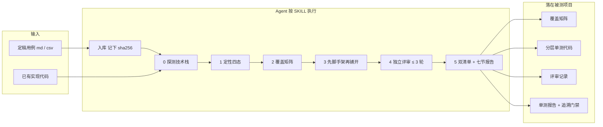

# testcase-to-unittest

[](https://skills.sh/zouaiyong/testcase-to-unittest)

把已定稿、带 TC 编号的功能测试用例，落成可进 CI 的分层自动化单测。

断言只来自用例判据。实现与判据不符时，测试保持失败，交给开发改实现——**不改断言、不改开发代码、不用跳过标记洗绿**。

> 平台简介（可直接贴到托管页的 Description）：把已定稿、带 TC 编号的功能测试用例（XMind 版 Markdown 或 Excel/CSV）落成纯口径层与规则层自动化单测。断言只来自用例判据，产出覆盖矩阵、独立评审记录、七节单测报告和 TC→测试追溯门禁。对 Agent 说「写单测 / 补单测」并给出用例路径与被测项目即可。不从 PRD 设计用例，不改开发实现。

## 全景




三条分流（阶段 1 定性之后）：

| 定性 | Agent 做什么 | 不做什么 |
|---|---|---|
| **可自动化** | 进覆盖矩阵，写纯口径层 / 规则层单测 | 不写必须连真库、真接口或浏览器才能成立的脚本 |
| **仅人工** | 缺口记进报告，附页面判据原文 | 不写 UI 自动化 |
| **整条阻塞** | `无实现` 或 `判据未定` 登记为不覆盖，附证据 | 不硬写、不把阻塞项算进「已写」 |

判据与实现不符时保持失败，这是另一条硬约束，不是交付的可选项。

## 使用方式

### 1. 安装

```bash
npx skills add zouaiyong/testcase-to-unittest
```

默认装到 `~/.agents/skills/testcase-to-unittest`。WorkBuddy、Claude Code 不读这个目录，装完后把该路径链到各自的 skills 目录：

| Agent | 链到 |
|---|---|
| WorkBuddy | `~/.workbuddy/skills/testcase-to-unittest` |
| Claude Code | `~/.claude/skills/testcase-to-unittest` |

Windows 建不了软链接就用目录联接。也可以把本仓库直接放到上述目录。目录里必须有 `SKILL.md`。链好后**新开一轮对话**才会被发现。

### 2. 你要准备什么

两样都要有，缺一不可：

1. **定稿功能用例**：`{需求名称}-测试用例.md` 或 `{需求名称}-测试用例.csv`（`testcase-design` 的两种产物都能读），每条有稳定 TC 号。
2. **被测代码已经存在**的项目（打开该项目再跟 Agent 说）。

还没写用例 → 用 `testcase-design`。只要评审用例写得好不好 → 用 `testcase-closed-loop`。没有功能用例、只想给某个类随手补测试，不要用本 skill。

### 3. 对 Agent 怎么说

已经加载本 skill 之后，直接说意图并带上路径，例如：

- 「对着用例把能单测的写成单测，用例在 `D:\cases\存储费管理\存储费管理-测试用例.md`」
- 「补单测，先做 TC-0003 到 TC-0010」
- 「用例更新了，按新版重新入库再改受影响的单测」
- 「单测红了，开发说是用例写错」——Agent 应按权威源顺序核对，**不会为了变绿去改用例或改实现**

没给用例路径时 Agent 会先问，不会自己到仓库外翻。同一需求 md 和 csv 都有时，会先确认以哪份为准。

触发词不必精确：写单测、补单测、覆盖矩阵、判据门禁、TC 编号、用例入库，都会走本 skill。

### 4. Agent 实际会做的事

1. **入库**：把定稿用例复制进项目 `doc/testcases/`，记下 sha256 作为本次判据基线。
2. **探测**：查语言 / 测试框架 / mock / 构建插件版本，跑一次基线记下条数。
3. **定性与拆解**：每条 TC 找到代码落点，定四态、定层、定 Tag，矩阵落盘。
4. **实现**：先搭脚手架，用一条靶子用例验证，再按矩阵铺开。只写 **纯口径层**（纯函数口径）和 **规则层**（mock、不起容器不连库）。
5. **独立评审**：另开子 Agent 按 10 个维度挑刺，最多 3 轮；终止条件是「评审通过」或「用满 3 轮」，不是「测试变绿」。
6. **交付**：覆盖矩阵、评审记录、失败定位清单、七节单测报告，并跑追溯脚本。结论只有「通过」或「未完成」。

执行细则、每阶段完成标准在 [SKILL.md](SKILL.md) 和 [references/stage-contracts.md](references/stage-contracts.md)。

### 5. 你会拿到什么

产物都写在**被测项目**里，不在本 skill 仓库：

| 产物 | 位置 |
|---|---|
| 分层测试代码 + 共享脚手架 | 测试源码树，目录与被测类镜像 |
| 自动化覆盖矩阵（来源 / 基线 / 四态 / 矩阵） | `doc/testcases/{需求名称}-自动化覆盖矩阵.md` |
| 评审记录（原文只追加不改写） | `doc/testcases/{需求名称}-评审记录.md` |
| 七节单测报告 + 失败定位清单 | `doc/testcases/{需求名称}-单测报告.md` |
| TC → 测试追溯 | `python scripts/check_tc_refs.py`，退出码进 CI |

交付前会核对：用例副本 hash 与入库基线一致、测试方法数对得上矩阵、追溯脚本退出码为 0。对不上则报告只能是「未完成」。

## 和相邻 skill 的边界

| 你要做的事 | 用哪个 |
|---|---|
| 从 PRD / 需求写功能用例 | `testcase-design` |
| 把用例评审到可入库 | `testcase-closed-loop` |
| 对着用例写单测、建追溯门禁 | **本 skill** |
| 改开发实现让功能符合用例 | 交给开发，本 skill 不改生产代码 |

与语言、业务域无关。当前附录是 Java / Maven / JUnit5 / Mockito；其他栈在阶段 0 探测后按同样格式补 `references/<栈名>-pitfalls.md`。

## 开发本 skill

- `python scripts/check_tc_refs.py --selftest`：追溯脚本回归。
- `evals/`：带 skill / 不带 skill 的对照评测，见 [evals/README.md](evals/README.md)。
